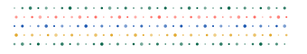

<div align="center">

  <h1>Stiprā</h1>

  <p>A programmable printmaking studio.</p>

  

  <p><sub><strong>Stiprā</strong> /ˈstip.raː/ <em>adj., Latvian</em> — feminine definite form of <em>stiprs</em>, “strong.”<br/>Also shaped by <em>stippling</em> + <em>strata</em>: dots arranged in layers.</sub></p>

  <p><strong>Separate the inks. Keep the imperfections.</strong></p>

  [](ROADMAP.md)
  [](LICENSE)
  [](package.json)
  [](docs/ARCHITECTURE.md)
  [](https://github.com/yigit-denktas/stipra/issues)

</div>

**Stiprā** is a local-first printmaking studio and experimental JavaScript library. Bring a photograph, handmade illustration or Canvas/p5.js drawing; separate it into spot inks or CMYK, or supply the ink masks yourself. Inspect each pass, adjust its screen, and export aligned plates with a reproducible recipe. Keep drawing in your existing tools.

The macron belongs to the display name; the repository, URL and CLI use `stipra`.

**[Open the studio](https://apps.yigitdenktas.com/stipra/) · [Canvas/p5.js examples](https://apps.yigitdenktas.com/stipra/sketches/) · [Reproduction guide](https://apps.yigitdenktas.com/stipra/guide/) · [Getting started](docs/GETTING-STARTED.md)**

## Try it

The **browser studio** processes supported PNG, JPEG, WebP and restricted SVG locally. Choose a shared Style or edit spot/CMYK masks, inspect the proof and individual plates, and save a print-package ZIP. No account or image API is needed. See [input limits](docs/IMPORT.md).

For creative coding, the [core API](packages/core/README.md) accepts sRGB pixels or authored ink coverage. The optional [Canvas/p5 adapter](packages/canvas/README.md) applies Stiprā in a **2D** sketch, freezes its source frame and exports aligned plates. The `@yigit-denktas/stipra-*` packages are published at `0.1.0-alpha.1`.

Prefer a script? With Node.js 20+ installed:

```sh
npm install
npm run prepare:fonts
node bin/stipra.js separate \
  --input artwork.png \
  --config examples/recipes/spot-photo.json \
  --screen examples/recipes/screens-spot.json \
  --out out/my-first-print
```

This creates grayscale plates, previews, recipes and provenance without changing the original. The [print-package command](docs/PRINT-PACKAGE-v1.md) produces a ZIP with aligned masters, an A4 PDF/HTML inspection report, diagnostics and normalized recipes. Use a fresh output directory.

## Where we are

**Implemented:** import, spot/CMYK masks, raster screening, [shared Styles](docs/STYLES-v1.md) and opt-in [tonal recipes](docs/TONAL-DETAIL-REVIEW.md), LPI/DPI settings, ink diagnostics, browser/CLI packages, a lean core, Canvas/p5 integration and authored-ink replay.

**Digital evidence:** [the alpha evaluation](docs/CREATIVE-CODING-ALPHA.md) records performance, compatibility, bundle sizes and six browser/Node/CLI export-parity cases. Large renders are synchronous.

**Delivery:** [Roadmap](https://apps.yigitdenktas.com/stipra/roadmap/) · [Delivery map](https://apps.yigitdenktas.com/stipra/delivery/) · [Changelog](https://apps.yigitdenktas.com/stipra/changelog/) · [Site map](https://apps.yigitdenktas.com/stipra/sitemap/). [Studio workflow](docs/STUDIO-WORKFLOW.md): 2–8 inks, recipe comparison and editable plates.

**Structured inputs:** named regions → inks and frozen source projects (#83/#84). [Try the region example](https://apps.yigitdenktas.com/stipra/regions/). [Contracts and evidence](docs/STRUCTURED-INPUTS.md) cover replay, OpenRaster and C2PA pilots; Apple/EXR and browser credentials are deferred.

**CLI:** [Compare, batch, export and verify](docs/CLI-WORKFLOWS.md), with JSON results and optional proof formats.

**Release:** [Studio v0.9.0-rc.1](https://github.com/yigit-denktas/stipra/releases/tag/v0.9.0-rc.1) is an experimental prerelease. [Editorial drawing trial](docs/CREATIVE-USE-2026-10-19.md).

**Acceptance:** [Studio scope and evidence](docs/STUDIO-RC-0.9-rc.1.md) · [Scoped CI gates](docs/RELEASE-CANDIDATE.md). Native bundles await [component notices](docs/DEPENDENCY-AUDIT.md). Human accessibility open; [report parity](docs/OWNER-REPORT-CONTRACT-v2.md) revised; photo acceptance pending; physical/artist trials deferred. Previews are digital approximations; branding provisional.

**Research:** [Study #109](docs/RECONSTRUCTION-STUDY-01.md) open; #113/#114 proposed.

## Follow the work

[Roadmap](ROADMAP.md) · [Alpha tracker #70](https://github.com/yigit-denktas/stipra/issues/70). Keep original photographs and image-bearing packages private unless redistribution is authorized.

[Design principles](DESIGN.md) · [Printmaking rules](docs/PRINT-DESIGN-RULES.md) · [Reference library](docs/references/README.md) · [Architecture](docs/ARCHITECTURE.md)

To contribute, read [CONTRIBUTING.md](CONTRIBUTING.md) and [AGENTS.md](AGENTS.md). Stiprā-authored code is [MIT-licensed](LICENSE), with [third-party notices and asset exceptions](docs/LICENSING.md).

**Make a mark. Separate its inks.**
