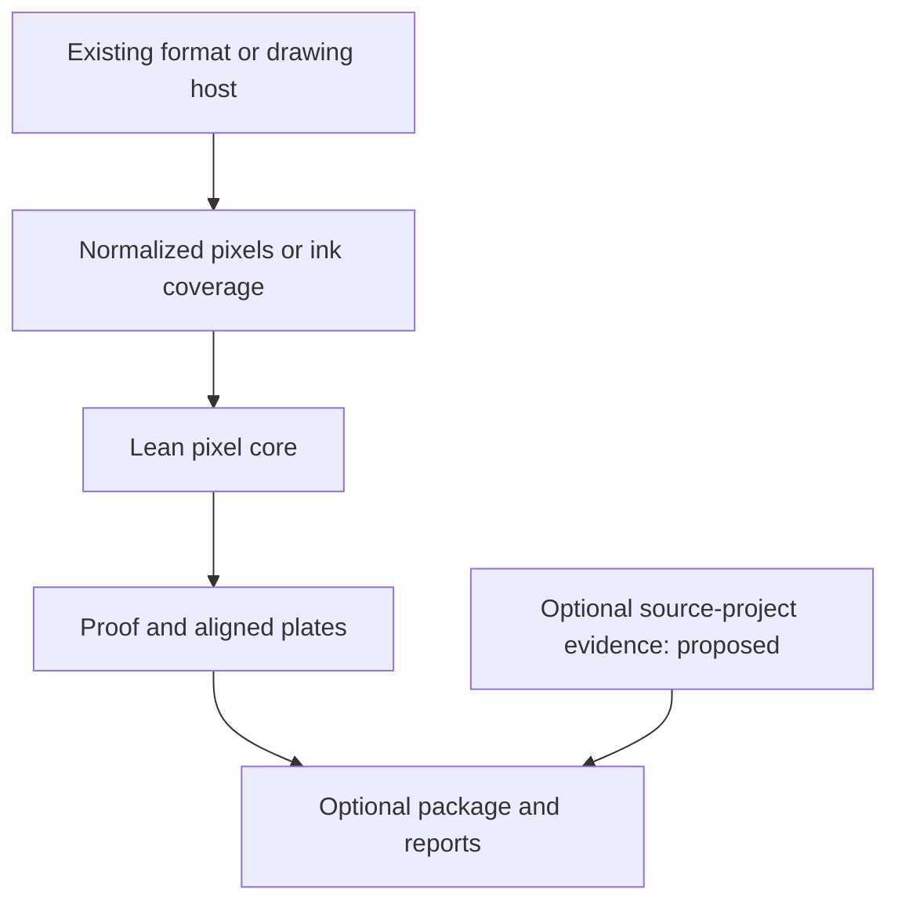

# Preserve construction data before estimating it

Research and architecture decision, 17 October 2026. Implementation/feasibility follow-through: [structured inputs](STRUCTURED-INPUTS.md). Parent #81; follow-ups #82–#86. This note evaluates an owner-supplied discussion using primary specifications and the current implementation. The private discussion and owner artwork are not redistributed here.

Stiprā should accept what the artist already knows, then make explicit ink decisions. Keep drawing, scene creation, capture and model inference in the existing host. The lean core continues to consume normalized pixels or final per-ink coverage; optional adapters interpret richer source material.

## What already exists, and what does not

| Input | Current implementation | Remaining gap |
| --- | --- | --- |
| Flattened PNG/JPEG/WebP | Local bounded import, source-byte preservation, oriented 8-bit sRGB pixels, editable separation and screening | Full metadata inventory, HDR/RAW/depth decoding and semantic reconstruction are absent |
| Canvas/p5 artwork | Owned frozen-frame capture, explicit density/alpha, drawable proof and optional export | Original drawing code, parameters and scene relationships are not captured automatically |
| Authored ink passes | One to eight named 8-bit coverage buffers/canvases, explicit polarity, solid marks, source mask hashes and replay | A named object/region is not yet a separately mapped source entity; many regions cannot be remapped to fewer inks with a saved mapping recipe |
| Native procedural vector recipe | `src/core.js` and the `scene` CLI retain supported geometry and emit vector ink scenes | This is a distinct engine/contract from `src/sdk`; imported SVG is not automatically converted to that scene schema |
| Restricted SVG import | Original retained as inert text; safe reconstructed subset rasterized for the image path | Arbitrary SVG layers, typography, filters and vectors are not preserved as editable image-separation geometry |
| Source history | Original file hash or generated source-mask descriptor, normalized recipes and source representation | Declared origin is not independently authenticated; C2PA validation, generator project archives and general auxiliary passes are not implemented |

The architecture document previously described image separation and reports as future work and PDF output as a headless-browser plan. It is corrected alongside this note: the current report writer uses `pdf-lib`, and the lean pixel SDK, Canvas adapter and shared raster package writer are implemented.

## Keep six meanings separate

1. **Color:** sRGB artwork values after a declared conversion. These are visual image data.
2. **Opacity:** alpha/coverage at an edge. An RGBA alpha channel is not automatically an object label or a complete scene decomposition.
3. **Region identity:** an authored or renderer-provided selection such as foreground trunks. It may have fractional edge coverage; an RGB object-ID image is a different encoding and must not be treated as luminance.
4. **Scene measurements:** depth, disparity, normals and material properties, with their own units, orientation, validity and sampling rules.
5. **Ink coverage:** the final 0–255 grayscale mask for a physical pass. This is what the existing core screens and exports.
6. **Evidence:** original bytes, generator parameters, rights declarations and validated credentials. A filename, prompt or SHA-256 alone does not establish authorship or depicted truth.

Example: a source has 30 tree objects, but the print uses three inks. Those are 30 selectable regions, not 30 physical ink passes. A mapping adapter should combine chosen regions into three coverage masks and then call `renderLayers`. It must record the combination rule: `max(0.5,0.5)=0.5`, while alpha-over gives `0.5 + 0.5 × (1−0.5)=0.75`. Neither result is universally correct for every artist's intent. Avoid implicit summing, invented semantic labels or a second screening stage.

For a generated forest, retaining foreground/background masks is more controllable than trying to infer them later from the RGB proof. For a photo or flattened AI image, an external estimated mask can be useful, but its producer, parameters and estimated status must remain visible. Do not claim the source scene was recovered.

## Findings from primary sources

**PNG carries more than ordinary 8-bit color.** The W3C specification permits sample depths through 16 bits, animation, EXIF and additional color/HDR signals. `cICP` has higher precedence than other recognized color chunks. A decoder accepting a file does not establish cross-host interpretation. Our working representation remains 8-bit sRGB; preservation of original bytes is different from preservation of original numerical precision. [PNG Third Edition](https://www.w3.org/TR/png-3/).

The bounded #82 fix records PNG source depth and warns about 16→8 normalization. It rejects APNG, unvalidated color/mastering signals and nonidentity PNG EXIF orientation before decoding. Only the full-range sRGB `cICP` tuple `[1,13,0,1]` is allowed, with combined cICP/ICC rejected until independently tested. Existing ICC-only SDR behavior remains covered by the established color references. Mastering metadata can describe SDR too; rejecting it means **unvalidated**, not “detected HDR.” This is not a complete HDR detector, tone mapper, or general PNG EXIF implementation. Files can be explicitly converted to an orientation-normalized SDR sRGB still by the author's chosen tool.

**Depth is not a grayscale photograph or a full 3D model.** Apple exposes depth/disparity through `AVDepthData` and records calibration/quality information. Orientation edits must also transform the auxiliary data. The supplied map may follow the camera's distortion rather than an ideal rectilinear camera. Preserve units, accuracy and its correspondence with the image; do not guess them from pixel brightness. Depth-enabled capture is conditional, not a property of every iPhone file. [AVDepthData](https://developer.apple.com/documentation/avfoundation/avdepthdata) and [orientation transforms](https://developer.apple.com/documentation/avfoundation/avdepthdata/applyingexiforientation(_:)).

**Render passes require their native semantics.** OpenEXR supports named numeric channels and distinct data/display windows; its alpha convention can differ from our straight-alpha sRGB input. Cryptomatte already addresses object/material mattes with transparent, blurred and antialiased contributions. Reuse established extraction tools to supply selected normalized masks; do not interpret hashes as colors or discard fractional contributions. [OpenEXR technical introduction](https://openexr.com/en/latest/TechnicalIntroduction.html), [Cryptomatte specification and implementations](https://github.com/Psyop/Cryptomatte). No EXR/Cryptomatte decoder is added by this work.

**Layered interchange is available; we do not need a new painting format.** OpenRaster specifies a ZIP with a layer-stack XML, layer assets and a merged preview. Its offsets, opacity and compositing semantics need an explicit compatibility subset; a painting layer is not necessarily an ink plate. Evaluate it after the simple mask mapping has a real user task. [File layout](https://www.openraster.org/baseline/file-layout-spec.html), [layer stack](https://www.openraster.org/baseline/layer-stack-spec.html).

**Procedural exports can retain geometry but not the original program automatically.** Processing's SVG library exports 2D vector geometry and can flatten 3D drawing into 2D. Source code, random state, fonts and external assets still need separate preservation if generator replay matters. Prefer the existing Processing bridge investigation (#75) and vector work (#28) to a replacement runtime. [Processing SVG reference](https://processing.org/reference/libraries/svg/).

**The current AI examples are capabilities, not source-format guarantees.** Qwen-Image-2.1's official repository documents native RGBA generation. OpenAI's current documentation confirms Content Credentials and SynthID for supported generated content and a verification tool. These points in the supplied discussion are supported as of this review. RGBA still does not establish independently editable objects, and signal coverage depends on the provider/path. Stiprā accepts suitable pixels/masks without adding a model dependency or promising AI-origin detection. [Qwen official README](https://github.com/QwenLM/Qwen-Image-2.1), [OpenAI provenance](https://openai.com/index/advancing-content-provenance/).

**Provenance needs explicit validation state.** CAI provides established C2PA tools, including a browser SDK using workers/WASM. A future optional reader should record whether credentials were inspected, whether asset binding validates, and whether the signer is trusted under the selected policy. Original-source credentials do not automatically authenticate the newly screened derivative. An absent credential does not prove AI or camera origin. Prefer existing validators to a home-grown verifier. Keep validation local by default, disable remote fetching, and do not upload private artwork to public verification services. [CAI web SDK](https://github.com/contentauth/c2pa-js/tree/main/packages/c2pa-web), [reading/validation tasks](https://opensource.contentauthenticity.org/docs/tasks/).

## Architecture decision

The lean core does not choose a decoder, inspect a source project, evaluate JavaScript, infer object masks, parse HEIF/EXR or verify signatures. It continues to use the existing deterministic pixel and coverage contracts.

A proposed named-region adapter sits before `renderLayers`, not inside the screening algorithm. A proposed source-project descriptor sits beside the current snapshot/recipes in the optional package, not inside `@stipra/core`. Vector scene recipes remain a separate supported path until a concrete interoperability contract is implemented and tested.

A source descriptor should relate explicit local artifacts using IDs, role, media type, byte hash, source frame/origin, transform, precision, alpha interpretation, producer/version, declared versus estimated origin and transformation history. Optional depth needs units, near/far direction and invalid-value rules; categorical IDs need a categorical sampler, not color-image filtering. Plain masks need no fabricated camera or scene metadata.

These are design requirements, not a newly supported JSON schema. Exact hashes can prove byte identity. They do not prove that a region name is true. Saving source code, seed and model settings can help generator replay, but determinism also depends on versions, assets, fonts and execution environment. Snapshot replay remains independently useful when the original generator cannot be rerun.

Source-project attachments must be explicitly selected, bounded and hashed; never follow manifest URLs or automatically execute archived code. Keep the existing private full-source package behavior explicit: originals may retain EXIF/GPS and project files may expose prompts or proprietary code. Any future public sharing mode needs deliberate selection/redaction rather than silently uploading the private package.

## Bounded sequence

| Work | Status / exit evidence |
| --- | --- |
| #82: PNG interpretation | Implemented in this change; original procedural fixtures verify precision metadata and pre-decode rejection in Node/browser |
| #83: named regions → inks | Implemented local alpha: same-frame masks, explicit combination rules, three-ink procedural forest and replay tests; no inference/codecs |
| #84: source-project sidecars | Optional package extension; explicit attachments, hashes, relationships, privacy and no automatic execution |
| #85: provenance validation | Completed local c2patool pilot and size/license/offline evaluation; browser adapter deferred |
| #86: layered/auxiliary formats | Completed bounded feasibility: OpenRaster subset, host-side Apple/OpenEXR extraction, source alignment, precision and color reference tests |
| #75 / #28 / #12 | Reuse existing Processing, vector and broad interchange work rather than duplicating it |

Native HEIC/RAW/EXR/PSD editing, full scene graphs, depth estimation, automatic segmentation, AI-origin classifiers and a new drawing IDE are outside this decision. No new dependencies, codecs, image generation or core API fields are added. An optional adapter earns implementation through a real artwork and a reproducible test, not through the number of formats it advertises.
